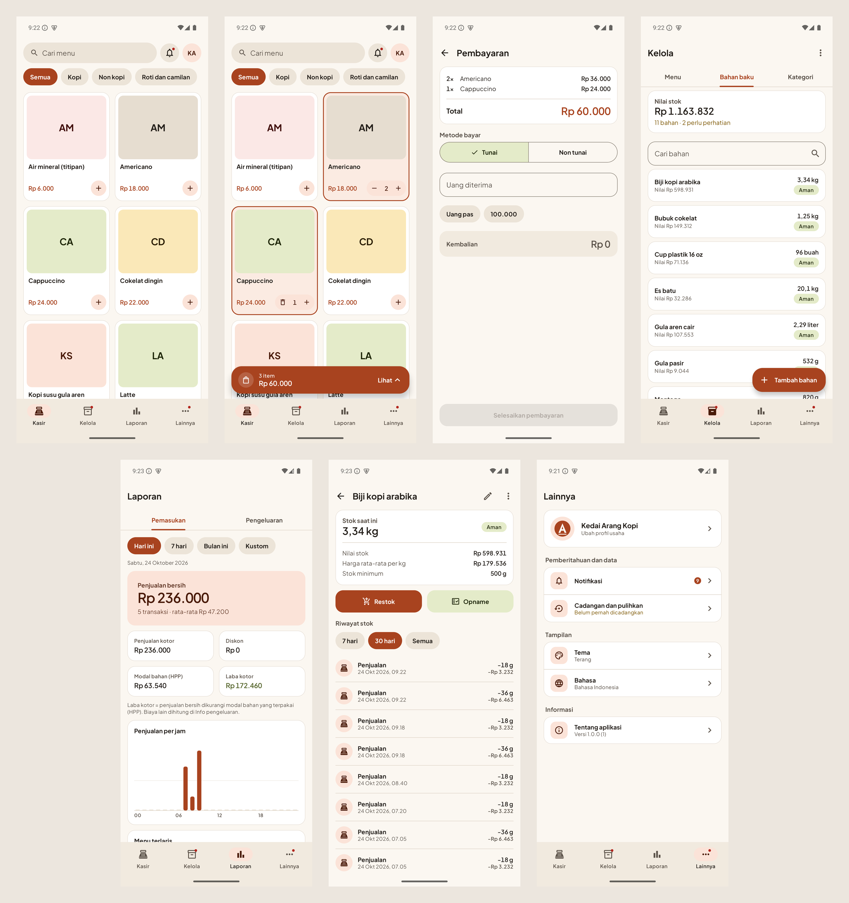

# Aplikasi Kasir ARN

Aplikasi kasir Android (Kotlin, Jetpack Compose) dengan database lokal untuk manajemen bahan baku berbasis takaran. Seluruh data tersimpan di ponsel dan aplikasi berjalan sepenuhnya *offline* (tanpa izin internet).



## Status

Versi 1.0.0 (build debug) sudah berjalan lengkap di emulator. Belum diuji di perangkat fisik dan Android 8 sampai 12. Rincian tahap, checklist, dan audit bug ada di [docs/IMPLEMENTATION_PLAN.md](docs/IMPLEMENTATION_PLAN.md).

## Fitur Utama

* **Kasir**: grid menu, keranjang (jumlah, catatan, diskon), pembayaran tunai dan non tunai, struk dibagikan sebagai teks atau gambar.
* **Menu dan resep**: resep per menu dengan takaran; HPP dan margin dihitung otomatis.
* **Bahan baku dan stok**: satuan dan takaran kustom, restok, opname, riwayat pergerakan; stok berkurang otomatis saat penjualan.
* **Laporan pemasukan dan laba**, **laporan pengeluaran dan arus kas** (dipisahkan dari laba).
* **Notifikasi** bahan hampir habis dan habis, serta pengingat cadangan.
* **Cadangan dan pulihkan** lewat berkas `.arnbak` (ZIP dengan checksum SHA-256, salinan pengaman, penggantian atomik).
* **Profil usaha**, **tema** terang/gelap/ikuti sistem (plus warna dinamis), **bahasa** Indonesia dan Inggris.
* **Data contoh** dalam tiga ukuran (sedikit, sedang, banyak) untuk mencoba semua fitur.
* Navigasi empat mode (Kasir, Kelola, Laporan, Lainnya); tata letak ponsel potret dan lanskap serta tablet.

## Teknologi

Kotlin 2.2, Jetpack Compose + Material 3, Navigation Compose, Room (KSP), DataStore, WorkManager, `core-splashscreen`. DI manual (`AppContainer`), tanpa pustaka pihak ketiga untuk grafik, gambar, cadangan, dan notifikasi. minSdk 26, targetSdk 36.

PRD semula menuliskan Flutter; implementasi memakai Kotlin native. Pemetaan teknologinya ada di [docs/IMPLEMENTATION_PLAN.md](docs/IMPLEMENTATION_PLAN.md) (Tahap 0).

## Menjalankan

Butuh Android Studio (atau JDK 17+ dan Android SDK 36).

```
./gradlew installDebug                  pasang ke emulator atau perangkat
./gradlew testDebugUnitTest             uji unit
./gradlew connectedDebugAndroidTest     uji instrumented
./gradlew lintDebug                     Android Lint
```

Data contoh: buka aplikasi saat masih kosong, lalu ketuk "Coba dengan data contoh" di Halaman Utama (atau Lainnya, Cadangan dan pulihkan) dan pilih ukurannya. Berkas dibangkitkan oleh `python tools/generate_data_contoh.py`.

## Struktur Repo

```
app/                              Modul Android (kode, sumber daya, uji, skema Room)
tools/generate_data_contoh.py     Pembangkit tiga skenario data contoh
CLAUDE.md                         Panduan dan aturan domain untuk Claude Code
docs/PRD.md                       Product Requirements Document
docs/IMPLEMENTATION_PLAN.md       Rencana implementasi bertahap dengan checklist dan audit
docs/TEST_CASES_TAKARAN.md        Kasus uji logika takaran, stok, dan biaya
docs/BACKLOG.md                   Daftar pekerjaan berurutan dan statusnya
docs/NAVIGASI_DAN_ADAPTIF.md      Peta navigasi dan tata letak adaptif
docs/DATA_CONTOH.md               Isi dan cara kerja data contoh
docs/screenshots/                 Tangkapan layar (terang, gelap, lanskap, tablet, warna dinamis)
```

## Lisensi

Font Plus Jakarta Sans (Tokotype) berlisensi SIL OFL 1.1, lihat [docs/OFL-PlusJakartaSans.txt](docs/OFL-PlusJakartaSans.txt). Lisensi kode belum ditentukan.
